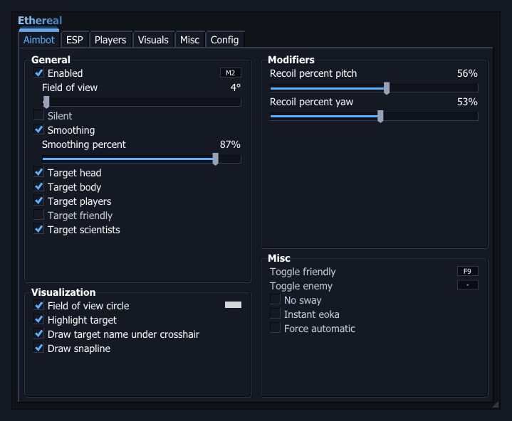
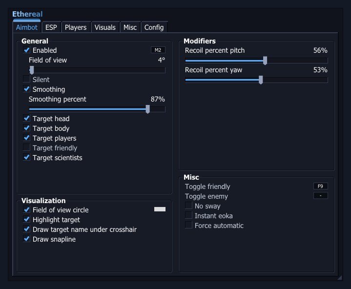
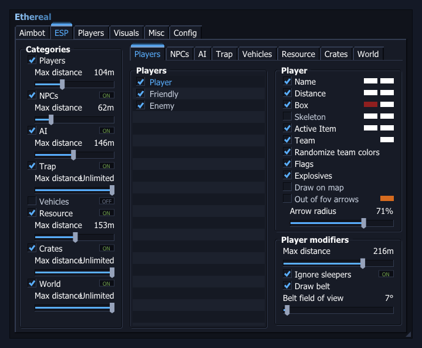
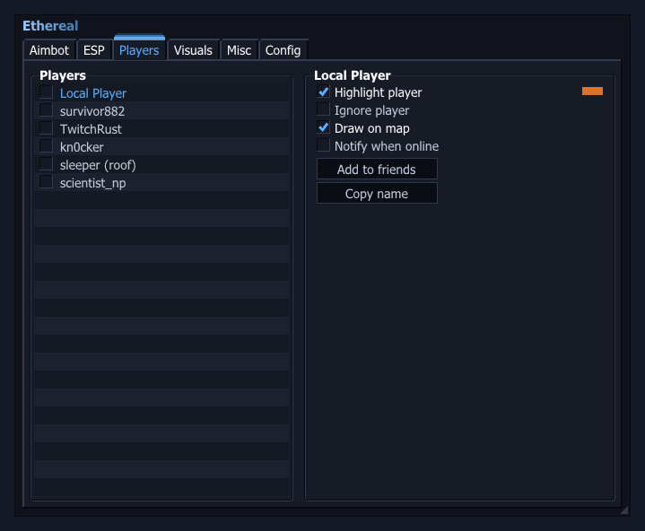
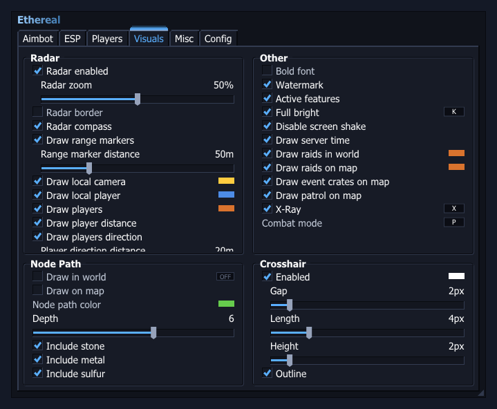
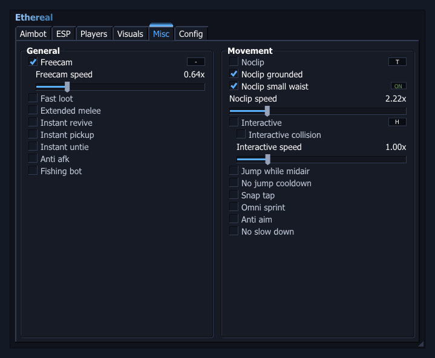
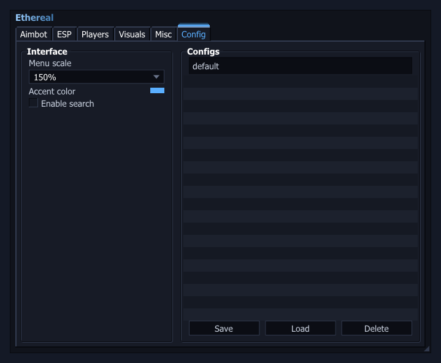

# Ethereal

ImGui menu framework (DirectX 11 / Win32) themed in Ethereal light and dark blue.

| Aimbot | ESP | Players |
|---|---|---|
|  |  |  |
| **Visuals** | **Misc** | **Config** |
|  |  |  |

## Build

Open `Ethereal/Ethereal.sln` in Visual Studio 2022 (v143 toolset) and build `Release | x64`. Press **Insert** to toggle the menu.

The menu renders at 150% by default and scales with the monitor DPI, so text and edges stay sharp on high-DPI displays. Change the size under **Config → Menu scale**.

Based on [ImGui-Menu-Chudvision](https://github.com/KingsleydotDev/ImGui-Menu-Chudvision) by KingsleydotDev.
